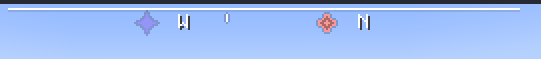

# Compass Plus

## About

Compass Plus is a client-side mod that adds a fancy little compass HUD that shows the cardinal directions, the world spawn, lodestones, and the point of your last death depending on the compasses in your inventory.

Available for Fabric and NeoForge.

## Planned Features

* (maybe) show the direction of treasure maps in your inventory
* compat with Quarks Compasses work Everywhere module
* a simple API for other mods to add their own POIs to the compass HUD

## License

This mod is released into the public domain under the [Unlicense](LICENSE). Do whatever you want with it.
